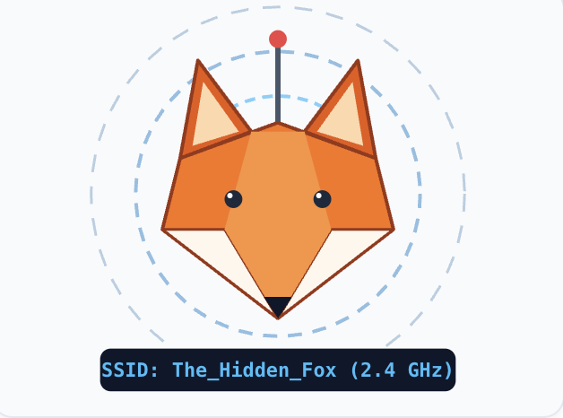
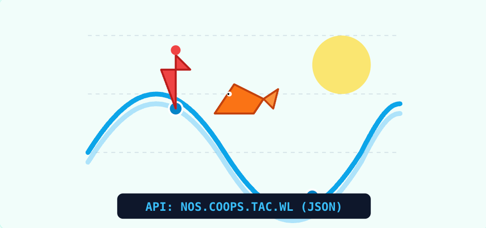
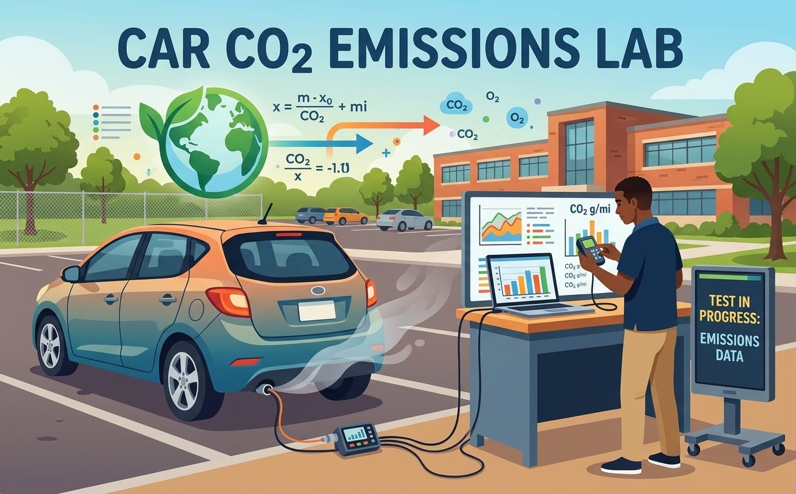
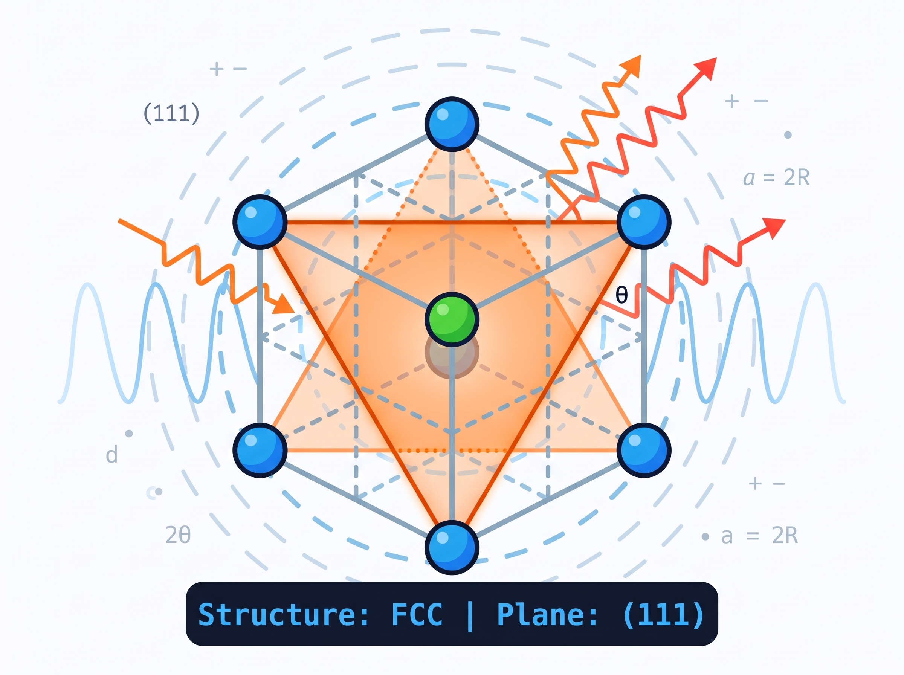

<style>
.tier-header {
  border-left: 5px solid #1a0b2e;
  padding-left: 12px;
  margin-top: 35px;
  margin-bottom: 20px;
}
.tier-badge {
  font-size: 0.85rem;
  font-weight: 600;
  padding: 4px 10px;
  border-radius: 9999px;
  background-color: #f1f5f9;
  color: #334155;
  display: inline-block;
  margin-bottom: 8px;
}
</style>

## 🔬 Tier 1: Foundations & Exploratory STEM {.tier-header}
**Target Audience:** Grades 6–9 (Middle School to Early High School)  
*Core Concepts: Physical intuition, environmental signals, wave matching, and introductory electronics.*

::: {.grid}

<!-- CARD 1: RF FOX HUNT -->
::: {.g-col-12 .g-col-md-4}
::: {.card .h-100}
<div style="text-align: center; background-color: #f8f9fa; padding-top: 15px; padding-bottom: 15px;">
  
</div>
::: {.card-body}
<span class="tier-badge">Grades 6–9 | Physics & RF</span>
<h5 class="card-title">RF Fox Hunt Lab</h5>
<p class="card-text">Direction finding and wireless physics. Track a Raspberry Pi 5 beacon using a waveguide, filter signal noise, and locate hidden transmitters.</p>
<a href="rf_foxhunt.html" class="btn btn-primary" style="background-color: #1a0b2e; border: none;">View Module</a>
:::
:::
:::

<!-- CARD 2: TIDE PREDICTOR -->
::: {.g-col-12 .g-col-md-4}
::: {.card .h-100}
<div style="text-align: center; background-color: #f8f9fa; padding-top: 15px; padding-bottom: 15px;">
  
</div>
::: {.card-body}
<span class="tier-badge">Grades 6–9 | Earth & Data Science</span>
<h5 class="card-title">Fishing Tide Predictor</h5>
<p class="card-text">Fetch live NOAA ocean level predictions via API, map local coastal fishing stations interactively, and plot sinusoidal tidal curves.</p>
<a href="tide_predictor.html" class="btn btn-primary" style="background-color: #1a0b2e; border: none;">View Module</a>
:::
:::
:::


<!-- CARD 3: RESONANCE DEFENDER GAME -->
::: {.g-col-12 .g-col-md-4}
::: {.card .h-100}
```{python}
#| echo: false
#| fig-height: 2.8
import matplotlib.pyplot as plt
import numpy as np

t = np.linspace(0, 4*np.pi, 100)
y1 = np.sin(t)
y2 = np.sin(t + np.pi/2)

fig, ax = plt.subplots(figsize=(5, 2.8))
ax.plot(t, y1, color='#10b981', linewidth=2.5)
ax.plot(t, y2, color='#ef4444', linewidth=2.5, linestyle='--')
ax.axis('off')
plt.tight_layout(pad=0)
plt.show()
```
::: {.card-body}
<span class="tier-badge">Grades 6–9 | Interactive Simulation</span>
<h5 class="card-title">Resonance Defender</h5>
<p class="card-text">Interactive RLC circuit wave simulator. Defend the power grid by balancing inductive and capacitive reactance to neutralize incoming AC sine waves.</p>
<a href="resonance_game.html" class="btn btn-primary" style="background-color: #1a0b2e; border: none;">Play Game</a>
:::
:::
:::

:::

---

## 📊 Tier 2: Applied Physics & Data Science {.tier-header}
**Target Audience:** Grades 10–12 (High School STEM, AP Physics, AP Computer Science)  
*Core Concepts: Python programming, data cleaning, scatter analysis, web automation, and regulatory modeling.*

::: {.grid}

<!-- CARD 4: CAR CO2 EMISSIONS -->
::: {.g-col-12 .g-col-md-4}
::: {.card .h-100}
<div style="text-align: center; background-color: #f8f9fa; padding-top: 15px; padding-bottom: 15px;">
  
</div>
::: {.card-body}
<span class="tier-badge">Grades 10–12 | Data Science & Policy</span>
<h5 class="card-title">Car CO2 Emissions Lab</h5>
<p class="card-text">Step into the role of an EPA auditor. Ingest cloud vehicle specs, overlay regulatory emissions thresholds, and explore the out-of-distribution EV intercept error.</p>
<a href="co2_emissions_regression.html" class="btn btn-primary" style="background-color: #1a0b2e; border: none;">View Module</a>
:::
:::
:::

<!-- CARD 5: LINEAR REGRESSION MODELING -->
::: {.g-col-12 .g-col-md-4}
::: {.card .h-100}
```{python}
#| echo: false
#| fig-height: 2.8
import matplotlib.pyplot as plt
import numpy as np

x = np.array([60, 61, 65, 66, 67, 68, 70, 73, 74, 75])
y = np.array([110, 120, 155, 160, 164, 170, 178, 215, 223, 235])

fig, ax = plt.subplots(figsize=(5, 2.8))
ax.scatter(x, y, color='#1c528b', s=50)
m, b = np.polyfit(x, y, 1)
ax.plot(x, m*x + b, color='#ed7953', linewidth=2.5) 
ax.axis('off')
plt.tight_layout(pad=0)
plt.show()
```
::: {.card-body}
<span class="tier-badge">Grades 10–12 | Applied Mathematics</span>
<h5 class="card-title">Linear Regression Modeling</h5>
<p class="card-text">Predict physical characteristics through mathematical optimization. Compute slopes, intercepts, residuals, and lines of best fit using Scikit-Learn.</p>
<a href="linear_regression.html" class="btn btn-primary" style="background-color: #1a0b2e; border: none;">View Module</a>
:::
:::
:::

<!-- CARD 6: API DATA CHALLENGE -->
::: {.g-col-12 .g-col-md-4}
::: {.card .h-100}
```{python}
#| echo: false
#| fig-height: 2.8
import matplotlib.pyplot as plt

years = ['2019', '2020', '2021', '2022', '2023']
pop = [1471317, 1465277, 1510715, 1540104, 1535141]

fig, ax = plt.subplots(figsize=(5, 2.8))
ax.plot(years, pop, marker='o', color='#1c528b', linewidth=2.5, markersize=8)
ax.fill_between(years, pop, color='#1c528b', alpha=0.15)
ax.axis('off')
plt.tight_layout(pad=0)
plt.show()
```
::: {.card-body}
<span class="tier-badge">Grades 10–12 | Data Engineering</span>
<h5 class="card-title">API Data Challenge</h5>
<p class="card-text">Pull live demographic data from open government databases using REST APIs. Parse JSON payloads, clean dirty data, and plot regional trends.</p>
<a href="outreach_data.html" class="btn btn-primary" style="background-color: #1a0b2e; border: none;">View Module</a>
:::
:::
:::

<!-- CARD 7: WEB SCRAPING -->
::: {.g-col-12 .g-col-md-4}
::: {.card .h-100}
```{python}
#| echo: false
#| fig-height: 2.8
import matplotlib.pyplot as plt
import numpy as np

np.random.seed(42)
x_nodes = np.random.rand(15)
y_nodes = np.random.rand(15)

fig, ax = plt.subplots(figsize=(5, 2.8))
for i in range(len(x_nodes)-1):
    ax.plot([x_nodes[i], x_nodes[i+1]], [y_nodes[i], y_nodes[i+1]], color='lightgrey', zorder=1)
ax.scatter(x_nodes, y_nodes, color='#ed7953', s=80, zorder=2)
ax.scatter(x_nodes[0], y_nodes[0], color='#1c528b', s=120, zorder=3)
ax.axis('off')
plt.tight_layout(pad=0)
plt.show()
```
::: {.card-body}
<span class="tier-badge">Grades 10–12 | Web Robotics</span>
<h5 class="card-title">Automating the Web</h5>
<p class="card-text">Introduction to DOM traversal and web automation. Program a Python bot to crawl online directories and bulk-extract files using BeautifulSoup.</p>
<a href="web_scraping.html" class="btn btn-primary" style="background-color: #1a0b2e; border: none;">View Module</a>
:::
:::
:::

:::

---

## 🧪 Tier 3: Advanced Materials & Engineering {.tier-header}
**Target Audience:** Grades 11–12, Early College & STEM Competitions  
*Core Concepts: 3D spatial geometry, crystallography, Miller indices, atomic packing factors, and X-ray diffraction.*

::: {.grid}

<!-- CARD 8: CRYSTAL STRUCTURES PART I -->
::: {.g-col-12 .g-col-md-6}
::: {.card .h-100}
<div style="text-align: center; background-color: #f8f9fa; padding-top: 15px; padding-bottom: 15px;">
  
</div>
::: {.card-body}
<span class="tier-badge">Grades 11–College | Materials Science I</span>
<h5 class="card-title">Crystal Structures & Miller Planes</h5>
<p class="card-text">Explore unit cells, coordination numbers, and packing factor derivations across SC, BCC, FCC, HCP, and Rock Salt ($NaCl$). Features an interactive HTML/JS crystal and Bragg's Law simulator.</p>
<a href="crystal_structures_part1.html" class="btn btn-primary" style="background-color: #1a0b2e; border: none;">View Part I</a>
:::
:::
:::

<!-- CARD 9: MARS ROVER XRD LAB PART II -->
::: {.g-col-12 .g-col-md-6}
::: {.card .h-100}
```{python}
#| echo: false
#| fig-height: 2.8
import matplotlib.pyplot as plt
import numpy as np

theta = np.linspace(10, 70, 200)
intensity = 500 + 3000 * np.exp(-((theta - 32.35)**2) / 2) + 800 * np.exp(-((theta - 45.1)**2) / 1.5) + np.random.normal(0, 50, 200)

fig, ax = plt.subplots(figsize=(5, 2.8))
ax.plot(theta, intensity, color='#d97706', linewidth=2)
ax.fill_between(theta, intensity, color='#d97706', alpha=0.15)
ax.axis('off')
plt.tight_layout(pad=0)
plt.show()
```
::: {.card-body}
<span class="tier-badge">Grades 11–College | Materials Science II</span>
<h5 class="card-title">Planetary Rover XRD Lab</h5>
<p class="card-text">Put crystal theory to work in a gamified space mission. Filter signal noise, identify unknown minerals using Bragg peak fingerprints, and compute alloy phase ratios with Python.</p>
<a href="mars_xrd_lab.html" class="btn btn-primary" style="background-color: #1a0b2e; border: none;">View Part II</a>
:::
:::
:::

:::